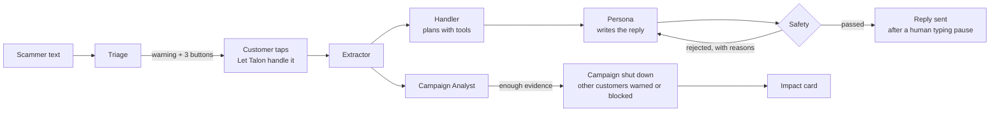

<p align="center"></p>

# Talon

**Every scam text is an invitation. Talon accepts it.**

Today, carriers block a scam text and throw it away. The scammer loses nothing, moves to the next number on their list, and keeps going. Honeypots try to fight back, but they only work when scammers happen to text a decoy. Talon starts from the scams customers already receive. When one arrives, Talon warns the customer. If they tap **Let Talon handle it**, a team of NVIDIA Nemotron agents takes over that conversation as a made-up person: slow, confused and cooperative. It never uses a single detail about the real customer. While the scammer thinks they're reeling in a victim, Talon gets them to hand over what they need to get paid: their payment handle, wallet, links and callback numbers. Then Talon shuts the whole campaign down. When the same scammer moves on to the next customer from a new number, with new wording, Talon recognizes the payment handle and blocks the text before that customer ever sees it. The customer who tapped the button sees exactly what they stopped. One tap turns a victim into the person who caught the scammer, and each scam they hand over protects the next customer.

Every step, from triage to each agent's reasoning, every tool call, every safety check and every extracted detail, streams live through **SpacetimeDB** to the phones and the dashboard as it happens.

---

## See it in 60 seconds

The live demo uses three phones. Judges scan QR codes at `/demo/qr`:

| Phone | Who | What happens |
| --- | --- | --- |
| **Sender** | A judge plays the scammer | Texts a scam (starter scripts included) and tries to get paid |
| **Customer** | A judge plays the customer | Gets *"SCAM DETECTED. This looks like a toll fee scam (85% sure)"* with **Let Talon handle it**, Report and Delete. Taps it, watches Talon reply, can tap **Stop** at any time, and gets an impact card at the end |
| **Second customer** | Nobody | The same scam arrives on its own from a different number, and triage warns on it. Once the campaign is shut down, the scammer's follow-up arrives reusing the payment handle Talon extracted, and it's **blocked on arrival**: *"this text uses the payment handle $TollDeskPay from a scam Talon shut down 2 minutes ago, thanks to a customer who handed it over."* |

The laptop shows `/demo/live`. Every agent step appears as it happens: the handler's plan (*have / need / tactic*), its reasoning, tool calls, safety rejections and rewrites, extracted details, the campaign shutting down, and the analyst's summary.

## How a takeover works



Each scammer turn runs through a LangGraph graph (`agents/talon_agents/engine.py`):

1. **Extractor** pulls indicators out of the scammer's text as JSON: links, phones, emails, payment handles, wallets, accounts, gift card asks and the brand being impersonated. Code then drops anything that isn't actually in the text or isn't a valid format.
2. **Handler** plans the reply in a reason → act → observe loop (up to 4 tool calls): `get_intel_gaps`, `get_category_playbook`, `lookup_indicator`, `choose_tactic`, `issue_tripwire`, `flag_bot_suspected` and `end_takeover`. It can only choose tactics the scam taxonomy allows for that kind of scam.
3. **Persona** writes the text in character, as a synthetic older adult from Nemotron-Personas-USA. It never sees any customer data.
4. **Safety** checks the draft with deterministic rules first, then a Nemotron reviewer. A rejected draft goes back to the persona with the reasons, up to 2 rewrites, after which a canned safe line is sent.
5. **Campaign Analyst** links the session to a campaign, decides whether to shut it down, warns other customers, and writes a summary for fraud analysts. **Shutting a campaign down is a rule enforced in code:** it needs 2+ sessions, or a payment ask inside a takeover the customer confirmed. The model can ask for a shutdown, but code refuses one without enough evidence.

A takeover ends when the customer taps Stop, Talon has what it came for, the scammer goes quiet, the turn cap is reached, or safety keeps failing. The customer then gets an **impact card** written by Nemotron. Any number in the card that doesn't appear in the underlying facts gets the card replaced by a template.

---

## Built on NVIDIA Nemotron

Talon is a multi-agent system, not a chatbot. Seven roles run on Nemotron, each with its own prompt and its own model-call budget (the four tool-using roles also have their own tool set), and each is reviewed by code.

| Agent | What Nemotron does | What code enforces |
| --- | --- | --- |
| **Triage** | Scam or not, scam type, probability and a plain-language reason. **Decides for itself when to retrieve:** it calls `search_similar_scams` only when unsure | Customer next steps come from the taxonomy, never the model. The warning threshold is a setting |
| **Extractor** | Indicators as structured JSON | Each value must appear in the text and match its format. Mislabeled emails and handles are recovered |
| **Handler** | Plans each turn with tool calls, with reasoning (`/think`) switched on for its first step | Tactics limited to the taxonomy. Tool budget of 4 calls |
| **Persona** | Writes the reply in character | Never sees customer data. No tools |
| **Safety** | Reviews every reply before it's sent | 15+ deterministic rules run first (below) |
| **Campaign Analyst** | Links campaigns, decides on shutdowns, writes summaries and impact cards | Shutdown evidence rule. Every number and identifier in a summary is checked against the data |
| **Scammer** (demo) | Rewords the scam for the second customer | Kept only if every link, number and handle survives |

**How we run Nemotron**

- **Self-hosted on an NVIDIA Brev GPU with vLLM.** `agents/brev/serve.sh` serves **Nemotron Nano 9B v2** with the tool-call parser from the model's own repo (`nemotron_json`) and automatic tool choice, behind an API key. We've verified it on an A100 80 GB: the endpoint check, a full takeover and the gold-set eval all run against it. The same client also works with NVIDIA's hosted API at build.nvidia.com. When running on Brev, conversation content stays on our own GPU server.
- **Reasoning switched per call.** `/think` and `/no_think` go into the system prompt (`llm.py`). The handler reasons once per turn, then acts quickly. Its reasoning is captured and shown live on the dashboard as "thought" steps.
- **Each agent can use its own model.** `TRIAGE_MODEL`, `SAFETY_MODEL` and so on, plus `{AGENT}_BASE_URL`, can point any agent at a different model or server. `ENABLE_GUARD=1 bash agents/brev/serve.sh` is set up to add **Llama 3.1 Nemotron Safety Guard 8B v3** on a second port, and the safety agent already parses its verdict format. We haven't tested the guard model end to end yet; today Nano does the safety review.
- **Nemotron-Personas-USA as the decoy's identity.** `scripts/data/fetch_personas.py` samples 40 synthetic people aged 60+ from NVIDIA's dataset, across different states. It keeps first names only and drops any persona whose text contains a phone number, email or link.
- **Endpoint smoke test.** `python -m talon_agents.check` confirms that a server handles plain replies, JSON, tool calls and `/think` before the engine relies on it.
- **Fixes from real failures.** `tests/test_guardrails.py` and `tests/test_humanlike.py` encode problems we saw on real Nemotron output: an email labeled as a link, the persona offering a phone call, AI-sounding replies. Each one is now caught in code.

**Safety rules applied to every reply** (`safety_rules.py`, before the model reviewer sees it): no links, emails, phone numbers, long digit strings or code; no attachments; no offers of a call or meeting; never admitting to being an AI or Talon; never sounding suspicious; at most 320 characters and 3 sentences; no em dashes, no multiple paragraphs and no assistant phrasing ("I'd be happy to…", "great question"). Fictional tripwire codes are the only exception.

### How well it detects scams

Measured with `python -m talon_agents.eval_gold` on our **181-message gold set** (`data/gold_test.jsonl`: 119 scams and 62 legitimate texts, including hard look-alikes such as real fraud alerts and one-time codes). The gold set is never used in prompts, retrieval or tuning. Results from our latest run on Nemotron Nano 9B v2:

| | Talon | Keyword baseline |
| --- | --- | --- |
| F1 | **0.898** | 0.561 |
| Recall (scams caught) | **0.891** | 0.403 |
| Precision | 0.906 | 0.923 |
| False alarms on legitimate texts | 17.7% | 6.5% |

- **Scam type correct** on 90.6% of caught scams.
- **Extraction:** 96.8% precision, 76.8% recall. Links and phone numbers are found almost every time; brand names are the weak spot.
- **Calibration:** Brier score 0.111. When Talon says 70% or more, the text is a scam about 9 times in 10.
- **Speed:** median triage 1.6 s.

**Where it falls short:** Talon flags more legitimate texts than the keyword filter does. At the 0.7 threshold the phone actually warns at, recall is 0.84 and false alarms are 14.5%. That trade-off is deliberate. A false alarm only shows a warning, because Talon never takes over a conversation unless the customer taps.

---

## Built on SpacetimeDB

SpacetimeDB is Talon's only database and its real-time layer. The engine, both phones, the live dashboard, the heatmap and the catalog all read and write through one module (`spacetimedb/src/index.ts`, published to Maincloud as `talon-prod`). The module has **31 tables and 44 reducers**. Reducers are the only way to write data, and every screen updates through live subscriptions. No screen polls.

**Rules enforced inside the database, not the UI**

- **Consent is enforced in a reducer.** `add_turn` rejects any Talon reply once the customer has tapped Stop, and any reply that didn't pass the safety check. That holds even if the engine has a bug.
- **The customer and Talon can't talk over each other.** `customer_send` is refused while Talon is handling the conversation.
- **Roles.** 36 reducers are admin-only and called by the engine's identity. Only 8 are open to the phones: `request_takeover`, `stop_takeover`, `scammer_send`, `customer_send`, `dismiss_message`, `reset_room`, `phone_opened` and `claim_admin` (first caller only). The open ones cap message length and rate-limit per room.
- **Validation at the edge.** Scam origins outside valid coordinates, and confidence values outside 0–1, are rejected.

**Real-time everywhere**

- **The agents' reasoning is streamed as data.** Every agent step (reasoning, tool call, tool result, safety rejection, output, with timings) is an `agent_step` row. The dashboard simply subscribes to it, so the entire reasoning trace is live with no extra API.
- **One store, many screens.** The customer phone, the scammer phone, `/demo/live`, `/agent-reasoning`, the scam catalog, the overview and the origins heatmap all use `useTable` subscriptions from `spacetimedb/react`. The heatmap places each scam text by its sender's area code (an approximate, city-level location), so the map fills in as sessions happen.
- **Presence through the connect/disconnect hooks.** Opening a phone calls `phone_opened`, which writes a `room_viewer` row for that connection. The `clientDisconnected` hook deletes it when the tab closes. The engine waits for someone to be watching the second customer's phone before sending the scammer's follow-up, so the block happens while someone is watching.

**History that builds itself**

- **The dataset grows from every session.** `set_triage`, `add_turn` and `add_customer_alert` write each triaged message, each scammer turn and each blocked text into `dataset_message`, labeled and with its indicators, inside the same transaction. The Overview page updates live. Every takeover produces labeled training data.
- **Nothing is lost on reset.** `chat_log` is append-only and a reset never deletes it. Before the demo's Reset clears a room, the module saves a full `session_archive` snapshot: messages, triage results, turns, the agent trace, plans, extracted details, campaigns, alerts and impact cards.
- **Scam catalog.** `record_scammer` keeps one entry per scammer number, with brands, extracted details and status. History can be imported with `import_scam_catalog`.

**Python talks to SpacetimeDB over its HTTP API.** SpacetimeDB has no official Python SDK, so `agents/talon_agents/spacetime.py` is a small client for reducer calls and SQL, including decoding of optional values and timestamps. `mirror.py` turns every engine write into an ordered reducer call on a background thread, so a slow network never slows a reply to the scammer. To pick up new work (texts from the scammer phone, taps on the customer phone), the engine queries the database every 0.5 s. Moving it onto a WebSocket subscription is on our list.

---

## Privacy and safety

- **Only the customer's tap starts a takeover**, and Stop ends it at once. The database enforces that no Talon reply is sent after Stop.
- **Talon always speaks as a synthetic persona.** The persona agent never receives the customer's name, number or any other detail.
- **Text only.** Every reply is screened for links, contact details, personal-data patterns and code before it's sent.
- **Every number and identifier is fictional.** Phone numbers use the reserved 555-01xx range, domains use `.example` and `.test`, and tripwire gift card codes are generated and marked as fake. No real customer data is used anywhere.
- **Nemotron can be self-hosted.** On Brev, conversation content never goes to a third-party model API.

## Run it

```bash
# Engine, offline (FakeLLM): the scripted toll scam with every agent step printed
cd agents
python -m venv .venv
.venv/Scripts/python -m pip install -r requirements.txt     # macOS/Linux: .venv/bin/python
.venv/Scripts/python -m talon_agents.cli --demo --fake
.venv/Scripts/python -m pytest                              # 138 tests, no network needed

# Real Nemotron: serve it on Brev (docs/BREV.md), set NEMOTRON_API_KEY/NEMOTRON_BASE_URL in .env, then
.venv/Scripts/python -m talon_agents.check                  # endpoint does replies, JSON, tools, /think
.venv/Scripts/python -m talon_agents.eval_gold              # gold-set scores vs the keyword baseline
```

```bash
# Full live demo, locally (three terminals, each starting at the repo root)
spacetime start --listen-addr 127.0.0.1:4000                # terminal 1: keep running

# terminal 2: publish the module, load the taxonomy and gold set, start the engine
spacetime publish --server http://127.0.0.1:4000 --module-path spacetimedb talon-dev -y
python scripts/data/import_spacetimedb.py --server http://127.0.0.1:4000 --db talon-dev
cd agents && .venv/Scripts/python -m talon_agents.live --server local --db talon-dev --room DEMO --setup-admin --reset
#   add --fake to run without Nemotron

# terminal 3: the web app (cd web && npm install first)
cd web && NEXT_PUBLIC_SPACETIMEDB_URI=http://127.0.0.1:4000 NEXT_PUBLIC_SPACETIMEDB_DB=talon-dev npm run dev
# open http://localhost:3000/demo/qr
```

More detail: [docs/LIVE_DEMO.md](docs/LIVE_DEMO.md) (running the demo), [docs/BREV.md](docs/BREV.md) (GPU setup) and [web/README.md](web/README.md) (sign-in and the dashboard pages).

## Repository

```text
agents/        Python engine: LangGraph graph, the agents, tools, safety rules, eval, live runner (tests in agents/tests)
spacetimedb/   The SpacetimeDB module: every table and reducer
web/           Next.js app: phones, live dashboard, overview, heatmap, scam catalog
data/          Scam taxonomy, gold test set, Nemotron-Personas-USA personas
scripts/       Data import and validation, demo seeding and smoke tests
docs/          Product requirements, architecture, data spec, taxonomy, demo and GPU guides
```

## What's next

`docs/PRD.md` and `docs/ARCHITECTURE.md` describe the full design, including parts we haven't built yet:

- Nemotron embeddings for retrieval and campaign clustering (both use exact and keyword matching today).
- A scored self-play arena: scammer agent vs Talon, judged by Nemotron.
- Voice takeovers ("Let Talon answer" on a scam call).
- Decoy canary numbers as a second source of conversations.
- A probe for AI-run scam bots, and simulated partner redemption of tripwire codes.
