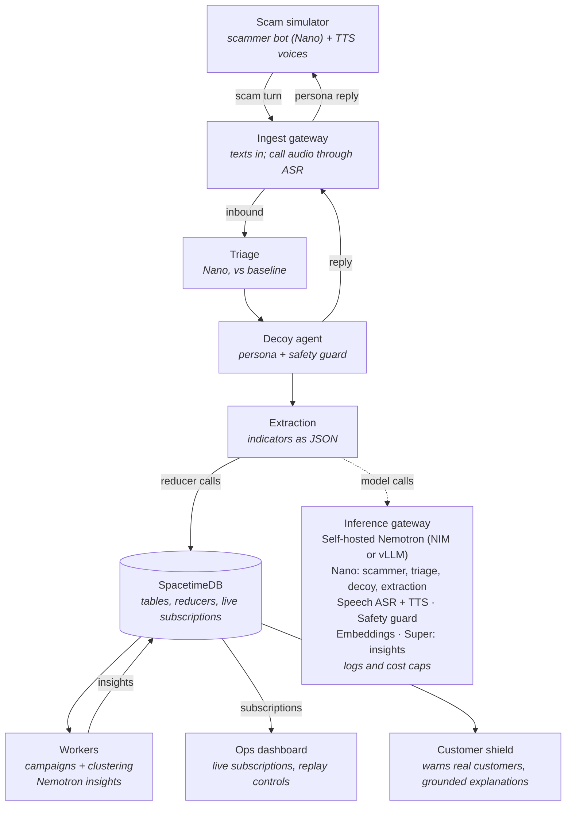
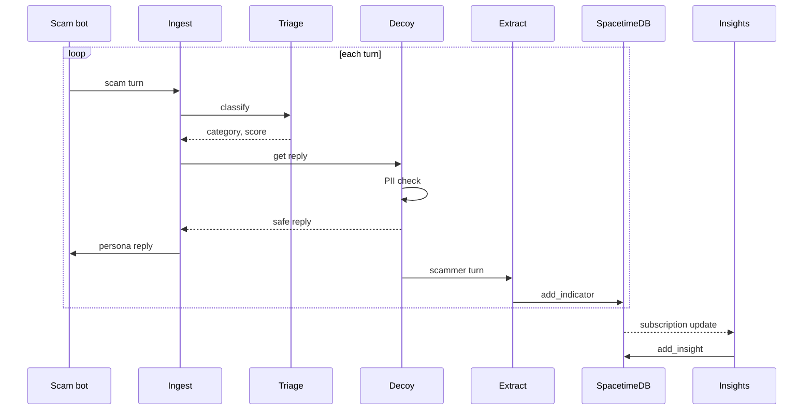

# Talon — Architecture

Nov 7, 2026

## System overview

The Talon pipeline (Python) handles each scammer turn synchronously: ingest, triage, decoy reply, safety check, extraction. After each step it writes to **SpacetimeDB**, the single store and real-time layer. Two workers subscribe to SpacetimeDB and turn raw events into campaigns and plain-language insights. The dashboard subscribes too, so it updates the moment a row lands.

For demos and testing, a scam simulator plays the scammer against the real decoy (agent vs agent). All model calls, including the simulator's, go through one self-hosted inference gateway.

## Data sources

T-Mobile is not providing data, so every input is ours. The scam taxonomy in [data/taxonomy.json](../data/taxonomy.json) drives triage labels, decoy tactics and customer next steps. The synthetic datasets in [DATA_SPEC.md](DATA_SPEC.md) feed the scam simulator, triage training and evaluation. All indicators in that data are fictional and can't reach anything real.

| Data | Used by |
| --- | --- |
| Taxonomy (`data/taxonomy.json`) | Triage labels, decoy tactic choice, scammer playbooks, extraction types, customer shield next steps |
| Messages and conversations | Scam simulator openers, triage training and testing, campaign clustering |
| Gold test set and baseline | Metrics panel (triage vs. baseline) |
| Personas (from Nemotron-Personas-USA) | Canary registry |
| Attack set and scam-bot transcripts | Safety guard leak test, scam-bot probe |
| Mock network signals | Campaign worker |

## Components

Thirteen components. The pipeline is Python, SpacetimeDB is the only database, and the two workers and the dashboard are TypeScript so they can use SpacetimeDB's subscription SDK.

| Component | Responsibility | Tech | Nemotron / NVIDIA model |
| --- | --- | --- | --- |
| Scam simulator (agent-vs-agent harness) | Plays the scammer: opening line from our synthetic set, playbook by taxonomy category. In voice mode, speaks each line with TTS | Python | Nemotron 3 Nano (scammer persona); NVIDIA TTS |
| Canary registry | Creates personas, assigns numbers and planting sources | Python | Nemotron-Personas-USA (dataset) |
| Ingest gateway | Receives canary texts and call audio. Audio goes through streaming ASR and is dropped after transcription | FastAPI | Nemotron Speech streaming ASR |
| Triage | Scam or not, taxonomy category, confidence, reason | Python | Fine-tuned Nemotron 3 Nano, or Nemotron embeddings + classifier head |
| Decoy agent | Persona conversation, tactic by category, turn limits, scam-bot probe. In voice mode, speaks replies with TTS | Python, NeMo Guardrails | Nemotron 3 Nano; NVIDIA TTS |
| Safety guard | Screens every outbound reply for PII, real data and unsafe content | Inline in the decoy's send path | Nemotron safety guard |
| Extraction | Pulls indicators from each turn into structured JSON, with regex checks | Python | Nemotron 3 Nano (structured output) |
| SpacetimeDB | Single store and real-time sync. Reducers are the only write path; every reader subscribes | SpacetimeDB module (Rust or C#) | None |
| Campaign worker | Clusters conversations into campaigns (embeddings held in memory), computes time-to-burn, issues mock tripwires and customer alerts | TypeScript, SpacetimeDB SDK | Llama Nemotron embedding model |
| Insight worker | Turns campaign facts into plain-language insights, checks every number against the data, writes Insight rows | TypeScript, SpacetimeDB SDK | Nemotron 3 Super (or Nano) |
| Event recorder and replay | Records every reducer call with its time offset during a real run; replays them in sync with the call audio | Python | None |
| Ops dashboard and customer view | Live views from subscriptions, replay controls, phone mockup | Next.js, SpacetimeDB TypeScript SDK | None |
| Inference gateway | Routes all model calls, logs prompts and outputs, enforces rate and cost limits | NVIDIA NIM or vLLM | Hosts all of the above |

SpacetimeDB's official client SDKs are Rust, C# and TypeScript, so the Python pipeline calls reducers over SpacetimeDB's HTTP API. Check the current SDK list and module languages before building.

## Request flow

Each scammer turn runs the loop below and lands in SpacetimeDB. The insight worker reacts to the change and writes an insight back, which the dashboard shows straight away.

Solid arrows are calls; dashed arrows are responses or subscription updates. The safety check runs before every reply leaves the decoy, so no unchecked text ever reaches a scammer. The campaign worker (not shown) subscribes the same way the insight worker does.

## Data model

All tables live in SpacetimeDB. Everything hangs off **Campaign**: a canary's conversation produces indicators, indicators tie conversations into campaigns, and campaigns get insights.

| Table | Key fields | Notes |
| --- | --- | --- |
| Canary | id, number, persona_id, planting_source, status, created_at | planting_source enables leaked-list tracing |
| Persona | id, name, age, location, backstory, quirks, memory_json | Synthetic only, seeded from Nemotron-Personas-USA |
| Conversation | id, canary_id, campaign_id, channel (sms or voice), run_id, started_at, turn_count, is_bot_suspected | run_id links a conversation to a recorded run |
| Turn | id, conversation_id, sender (scammer or canary), text, triage_label, confidence, safety_passed, ts | Voice turns store the transcript only, never audio |
| Indicator | id, type (url, phone, email, wallet, payment_handle, account, giftcard_ask, remote_access_id, brand), value, confidence, source_turn_id | Kept after raw text is deleted |
| Campaign | id, taxonomy_category, first_seen, burned_at, time_to_burn_s, status | Embeddings live in the campaign worker, not the table |
| Insight | id, campaign_id, kind (summary, new_pattern, customer_warning), text, cited_indicator_ids, confidence, created_at | Written only after every number is checked against the data |
| Tripwire | id, campaign_id, type (giftcard, wallet, account), token, issued_at, hit_at, hit_details | Mocked partners in the hackathon |
| ProbeResult | id, conversation_id, revealed_prompt, revealed_payment, success | From the scam-bot probe |
| CustomerAlert | id, campaign_id, customer_ref (hashed), message_hash, shown_at | Customer view stores hashes only |
| RecordedEvent | run_id, offset_ms, reducer, args_json | One row per reducer call in a recorded run; drives replay |

## Reducers and subscriptions

All writes go through SpacetimeDB reducers, and every reader subscribes to tables. The reply path stays synchronous inside the Python pipeline and writes to SpacetimeDB after each step, so the database never slows a reply.

### Pipeline entry points

| Endpoint | Caller | Purpose |
| --- | --- | --- |
| POST /ingest/message | Scam simulator (text mode) or SMS provider | One scammer text in; the persona reply comes back |
| WS /ingest/audio | Scam simulator (voice mode) or live call | Audio stream in; replies stream back as TTS audio |

### Reducers

| Reducer | Called by | Writes |
| --- | --- | --- |
| start_conversation | Ingest gateway | Conversation |
| add_turn | Ingest gateway, decoy agent | Turn |
| add_indicator | Extraction | Indicator |
| add_probe_result | Decoy agent | ProbeResult |
| upsert_campaign, burn_campaign | Campaign worker | Campaign, Conversation.campaign_id |
| issue_tripwire, hit_tripwire | Campaign worker (mock partners) | Tripwire |
| add_customer_alert | Campaign worker | CustomerAlert |
| add_insight | Insight worker | Insight |
| record_event | Event recorder | RecordedEvent |

### Subscriptions

| Subscriber | Tables | Reacts by |
| --- | --- | --- |
| Campaign worker | Indicator, Conversation | Clustering, burning campaigns, issuing tripwires and alerts |
| Insight worker | Campaign, Indicator, Tripwire, ProbeResult | Writing a grounded insight for each meaningful change |
| Ops dashboard | All tables | Live feed, campaigns, insights, metrics |
| Customer view | CustomerAlert, Insight (customer_warning) | Showing the warning on the phone mockup |

**Replay:** the replay tool reads a run's RecordedEvent rows and calls the same reducers in order at their original offsets, into a fresh demo database, while the call audio plays.

## Security and privacy controls

The design has three hard lines: no real customer data in canaries, no audio stored, and nothing but plain text ever sent to scammers.

| Threat | Control | Where enforced |
| --- | --- | --- |
| Decoy leaks real customer data | Personas are synthetic only; safety guard on every reply; persona validator rejects anything matching customer records | Canary registry, safety guard |
| Scammer manipulates the decoy (jailbreak) | NeMo Guardrails rails, a fixed system prompt, turn limits, a jailbreak check on inbound text | Decoy agent |
| Decoy sends something harmful | Outbound filter: plain text only, no URLs, attachments or code | Ingest gateway (outbound path) |
| Prompt-injection probe crosses a legal line | Scripted probe templates only, reviewed in advance; words in conversation only | Decoy agent |
| Recording and wiretap law | Streaming speech-to-text, audio discarded in memory; text-first build | Ingest gateway |
| Wrongful blocks from bad indicators | Confidence threshold, regex validation, at least 2 canaries or a high score before a network block | Campaign worker |
| Made-up numbers in insights | Insight worker checks every number against the source rows before writing | Insight worker |
| Sensitive data at rest | Raw text deleted after the retention window; customer data stored as hashes only; encrypted database | SpacetimeDB, retention job |
| Model data leaving the network | Self-hosted Nemotron; no third-party model APIs for conversation content | Inference gateway |
| Scammers flood canaries to run up cost | Rate and cost caps per campaign and per source number | Inference gateway |
| Insider misuse | Role-based dashboard access; audit log of every model call and export | Inference gateway, dashboard |

## Deployment

For the hackathon everything runs on one GPU machine: Docker Compose for the Python services plus one local SpacetimeDB instance. Production splits the same services across T-Mobile's network and adds the real integrations.

| Concern | Hackathon | Production |
| --- | --- | --- |
| Hosting | Docker Compose on one GPU box (or NVIDIA's hosted API as a fallback) | Kubernetes in T-Mobile data centers |
| Models | Nemotron 3 Nano, safety guard, embeddings, Speech ASR and TTS; Super via hosted API only if needed | NIM microservices with autoscaling per model |
| Scammer side | Scam simulator (agent vs agent) seeded from our synthetic set; voice runs recorded and replayed | Real scammers contacting real canary numbers |
| Canary numbers | Simulated | Never-assigned or long-dormant T-Mobile numbers |
| Data and real-time sync | One local SpacetimeDB instance | SpacetimeDB cluster, or Kafka + Postgres if carrier scale needs it |
| Blocking | Mock blocklist table | Scam Shield, Scam Callback Protection, Safe Web Browsing, traceback |
| Tripwires | Mock partner service | Retail, exchange and bank partner APIs |
| Customer shield | Phone mockup web page | T-Life app / Scam Shield notifications |
| Monitoring | Logs + dashboard metrics panel | Full observability, model-drift alerts, red-team reviews |
