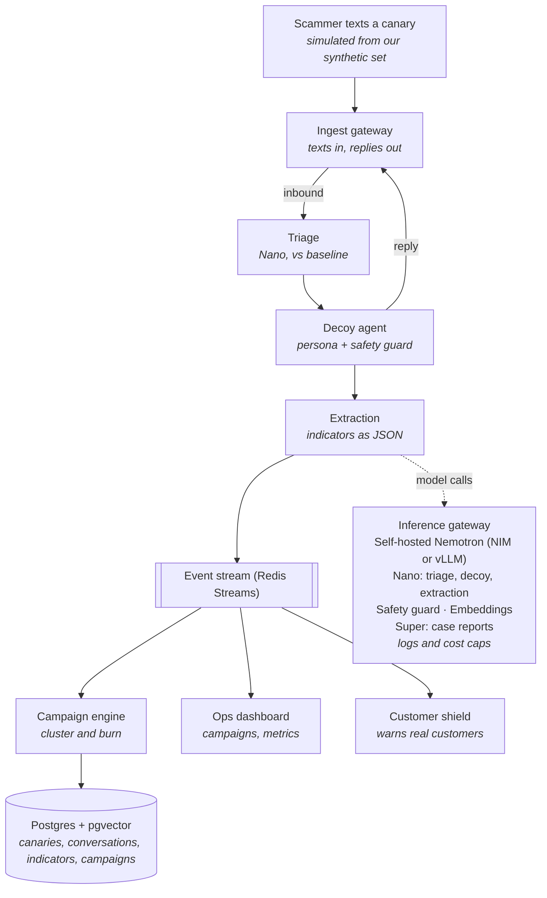
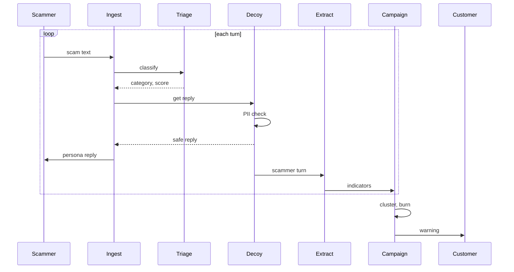

# Talon — Architecture

Nov 7, 2026

## System overview

The reply to a scammer runs synchronously through ingest, triage and the decoy agent. Everything after extraction runs on an event stream, so analytics never slow a reply down.

All model calls go through one self-hosted inference gateway, which handles logging, cost caps and keeping data on T-Mobile's infrastructure.

## Data sources

T-Mobile is not providing data, so every input is ours. The scam taxonomy in [data/taxonomy.json](../data/taxonomy.json) drives triage labels, decoy tactics and customer next steps. The synthetic datasets in [DATA_SPEC.md](DATA_SPEC.md) feed the SMS simulator, triage training and evaluation. All indicators in that data are fictional and can't reach anything real.

| Data | Used by |
| --- | --- |
| Taxonomy (`data/taxonomy.json`) | Triage labels, decoy tactic choice, extraction types, customer shield next steps |
| Messages and conversations | SMS simulator, triage training and testing, campaign clustering |
| Gold test set and baseline | Metrics panel (triage vs. baseline) |
| Personas (from Nemotron-Personas-USA) | Canary registry |
| Attack set and scam-bot transcripts | Safety guard leak test, scam-bot probe |
| Mock network signals | Campaign engine |

## Components

Nine services share one Postgres database and an event stream. Nemotron models run behind one inference gateway, so every model call goes through the same logging and safety path.

| Service | Responsibility | Tech | Nemotron model |
| --- | --- | --- | --- |
| Canary registry | Creates personas, assigns numbers and planting sources, stores persona memory | Python, Postgres | Nemotron-Personas-USA (dataset) |
| Ingest gateway | Receives canary texts (simulator for the demo; SMS provider in production), and voice via streaming speech-to-text | FastAPI; SMS simulator | Nemotron Speech streaming ASR (stretch) |
| Triage service | Scam or not, taxonomy category, confidence, reason | FastAPI | Fine-tuned Nemotron 3 Nano, or Nemotron embeddings + classifier head |
| Decoy agent | Persona conversation, tactic by category, turn limits, scam-bot detection and probe | Python agent loop, NeMo Guardrails | Nemotron 3 Nano |
| Safety guard | Screens every outbound reply for PII, real data and unsafe content | Inline in the agent's send path | Nemotron safety guard (Llama 3.1 Nemotron Safety Guard 8B or Nemotron 3.5 Content Safety) |
| Extraction service | Pulls indicators from each turn into structured JSON, with regex checks for URLs, phones and wallets | FastAPI | Nemotron 3 Nano (structured output) |
| Campaign engine | Clusters conversations into campaigns, computes time-to-burn, issues blocks and customer warnings, mock tripwires | Python worker, pgvector | Llama Nemotron embedding model; Nemotron 3 Super for case reports |
| Ops dashboard and customer view | Live campaigns, indicators, metrics; phone mockup with warnings | Next.js, server-sent events | None |
| Inference gateway | Routes all model calls, logs prompts and outputs, enforces rate and cost limits | NVIDIA NIM or vLLM | Hosts all of the above |

## Request flow

Each scammer text runs the loop below. The campaign engine burns the campaign and warns customers once it has enough indicators.

Solid arrows are requests; dashed arrows are responses. The safety check runs before every reply leaves the decoy, so no unchecked text ever reaches a scammer.

## Data model

Everything hangs off **Campaign**: a canary's conversation produces indicators, and indicators plus embeddings tie conversations into campaigns.

| Entity | Key fields | Notes |
| --- | --- | --- |
| Canary | id, number, persona_id, planting_source, status, created_at | One per decoy number; planting_source enables leaked-list tracing |
| Persona | id, name, age, location, backstory, quirks, memory_json | Synthetic only, seeded from Nemotron-Personas-USA |
| Conversation | id, canary_id, campaign_id, channel (sms or voice), started_at, turn_count, is_bot_suspected | Raw text deleted after the retention window |
| Turn | id, conversation_id, sender (scammer or canary), text, triage_label, confidence, safety_passed, ts | Voice turns store transcript only, never audio |
| Indicator | id, type (url, phone, email, wallet, payment_handle, account, giftcard_ask, remote_access_id, brand), value, confidence, source_turn_id | Kept after raw text is deleted |
| Campaign | id, taxonomy_category, first_seen, burned_at, time_to_burn_s, centroid_embedding, status | time_to_burn_s = burned_at minus first_seen |
| Tripwire | id, campaign_id, type (giftcard, wallet, account), token, issued_at, hit_at, hit_details | Mocked partners in the hackathon |
| ProbeResult | id, conversation_id, revealed_prompt, revealed_payment, success | From the scam-bot probe |
| CustomerAlert | id, campaign_id, customer_ref (hashed), message_hash, shown_at | Customer view stores hashes only |

## APIs and events

The decoy reply runs as synchronous calls, because it's latency-sensitive. Everything after extraction runs on events, so the campaign engine and dashboard never slow down a reply.

### Synchronous APIs

| Endpoint | Caller | Returns |
| --- | --- | --- |
| POST /ingest/message | SMS simulator or provider webhook | 202 Accepted; emits message.received |
| POST /triage | Ingest gateway | label, category, confidence, reason |
| POST /decoy/reply | Ingest gateway | reply text (already safety-checked), is_bot_suspected |
| POST /safety/check | Decoy agent | pass or fail, categories found |
| POST /extract | Decoy agent, after each scammer turn | list of indicators with confidence |
| GET /campaigns, GET /campaigns/{id} | Dashboard | campaign detail, indicators, time-to-burn |
| GET /campaigns/{id}/report | Dashboard | FTC/IC3-style case summary |
| POST /shield/check | Customer view | match or none; campaign, scam type, next step |

### Events (Redis Streams)

| Event | Producer | Consumers |
| --- | --- | --- |
| message.received | Ingest | Triage, dashboard |
| turn.completed | Decoy agent | Extraction, dashboard |
| indicator.extracted | Extraction | Campaign engine |
| bot.probe_result | Decoy agent | Campaign engine, dashboard |
| tripwire.issued / tripwire.hit | Campaign engine (mock partners) | Dashboard |
| campaign.burned | Campaign engine | Blocking (mock), customer shield, dashboard |
| training.sample_ready | Campaign engine | Triage retraining job |

## Security and privacy controls

The design has three hard lines: no real customer data in canaries, no audio stored, and nothing but plain text ever sent to scammers.

| Threat | Control | Where enforced |
| --- | --- | --- |
| Decoy leaks real customer data | Personas are synthetic only; safety guard on every reply; persona validator rejects anything matching customer records | Canary registry, safety guard |
| Scammer manipulates the decoy (jailbreak) | NeMo Guardrails rails, a fixed system prompt, turn limits, a jailbreak check on inbound text | Decoy agent |
| Decoy sends something harmful | Outbound filter: plain text only, no URLs, attachments or code | Ingest gateway (outbound path) |
| Prompt-injection probe crosses a legal line | Scripted probe templates only, reviewed in advance; words in conversation only | Decoy agent |
| Recording and wiretap law | Streaming speech-to-text, audio discarded in memory; text-first build | Ingest gateway |
| Wrongful blocks from bad indicators | Confidence threshold, regex validation, at least 2 canaries or a high score before a network block | Campaign engine |
| Sensitive data at rest | Raw text deleted after the retention window; customer data stored as hashes only; encrypted database | Postgres, retention job |
| Model data leaving the network | Self-hosted Nemotron; no third-party model APIs for conversation content | Inference gateway |
| Scammers flood canaries to run up cost | Rate and cost caps per campaign and per source number | Inference gateway |
| Insider misuse | Role-based dashboard access; audit log of every model call and export | Inference gateway, dashboard |

## Deployment

For the hackathon everything runs in one Docker Compose stack on one GPU machine. Production splits the same services across T-Mobile's network and adds the real integrations.

| Concern | Hackathon | Production |
| --- | --- | --- |
| Hosting | Docker Compose on one GPU box (or NVIDIA's hosted API as a fallback) | Kubernetes in T-Mobile data centers |
| Models | Nemotron 3 Nano + safety guard + embeddings on one GPU; Super via hosted API only if needed | NIM microservices with autoscaling per model |
| Canary numbers | Simulated; inbound texts replayed from our synthetic set | Never-assigned or long-dormant T-Mobile numbers |
| Ingest | SMS simulator script | Carrier messaging core; voice through streaming ASR |
| Data | Postgres + pgvector, Redis | Managed Postgres, Kafka for events, data warehouse for analytics |
| Blocking | Mock blocklist table | Scam Shield, traceback requests, takedown workflows |
| Tripwires | Mock partner service | Retail, exchange and bank partner APIs |
| Customer shield | Phone mockup web page | T-Mobile app / Scam Shield notifications |
| Monitoring | Logs + dashboard metrics panel | Full observability, model-drift alerts, red-team reviews |
