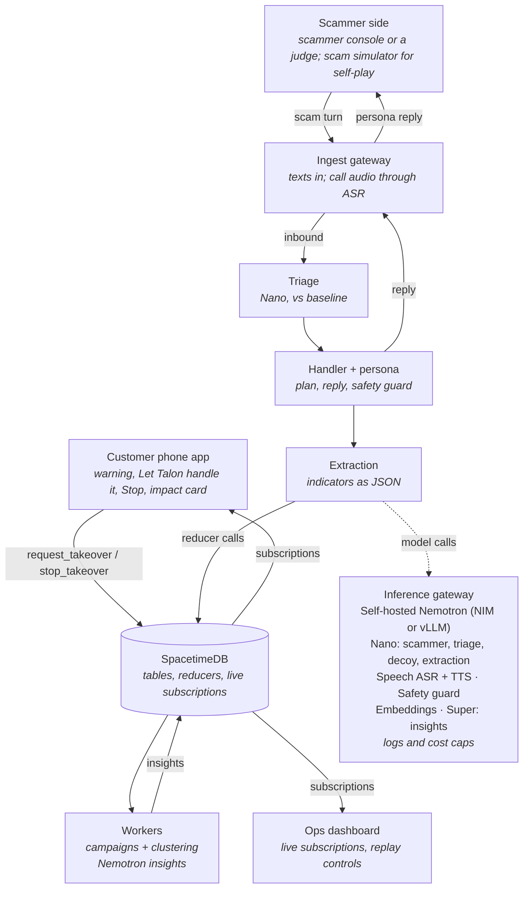
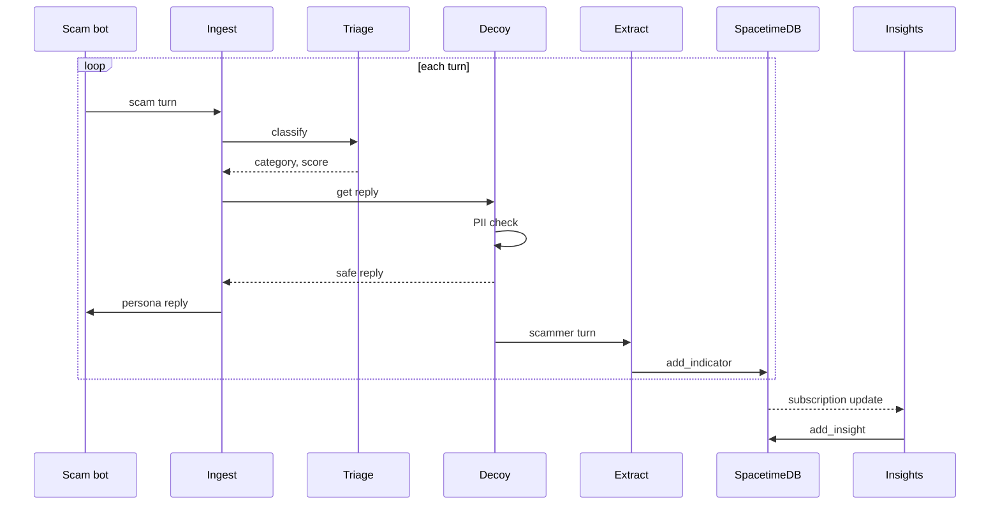

# Talon — Architecture

Nov 7, 2026

## System overview

Talon follows the "Let Talon handle it" model ([PIVOT.md](PIVOT.md)). A scam reaches a customer's phone, triage warns them, and if they tap **Let Talon handle it**, Talon's agent takes over that conversation as a synthetic persona. Canary numbers are a second source of the same kind of session.

The Talon pipeline (Python) handles each scammer turn synchronously: ingest, triage, handler plan, persona reply, safety check, extraction. After each step it writes to **SpacetimeDB**, the single store and real-time layer. Two workers subscribe to SpacetimeDB and turn raw events into campaigns and plain-language insights. The dashboard and the customer phone app subscribe too, so they update the moment a row lands.

In the demo a judge plays the scammer through a scammer console (or a phone call). For testing, a scam simulator plays the scammer against the real handler (agent vs agent, scored self-play). All model calls, including the simulator's, go through one self-hosted inference gateway.

Talon never takes over on its own: only the customer's tap starts a takeover session, and the customer can stop it at any time. Once a session is stopped or completed, SpacetimeDB rejects any further Talon reply.

## Data sources

T-Mobile is not providing data, so every input is ours. The scam taxonomy in [data/taxonomy.json](../data/taxonomy.json) drives triage labels, decoy tactics and customer next steps. The synthetic datasets in [DATA_SPEC.md](DATA_SPEC.md) feed the scam simulator, triage training and evaluation. All indicators in that data are fictional and can't reach anything real.

| Data | Used by |
| --- | --- |
| Taxonomy (`data/taxonomy.json`) | Triage labels, decoy tactic choice, scammer playbooks, extraction types, customer shield next steps |
| Messages and conversations | Scam simulator openers, triage training and testing, campaign clustering |
| Gold test set and baseline | Metrics panel (triage vs. baseline) |
| Personas (from Nemotron-Personas-USA) | Takeover sessions and canaries (Talon always speaks as a synthetic persona) |
| Attack set and scam-bot transcripts | Safety guard leak test, scam-bot probe |
| Mock network signals | Campaign worker |

## Components

Fifteen components. The pipeline is Python, SpacetimeDB is the only database, and the two workers and the dashboard are TypeScript so they can use SpacetimeDB's subscription SDK.

| Component | Responsibility | Tech | Nemotron / NVIDIA model |
| --- | --- | --- | --- |
| Scam simulator (agent-vs-agent harness) | Plays the scammer: opening line from our synthetic set, playbook by taxonomy category. In voice mode, speaks each line with TTS | Python | Nemotron 3 Nano (scammer persona); NVIDIA TTS |
| Customer phone app | Shows triage warnings with Delete / Report / **Let Talon handle it**, the "Talon took over" state with Stop, auto-blocks, and the impact card | Next.js, SpacetimeDB TypeScript SDK | None |
| Scammer console | Web page where a judge (or tester) texts as the scammer, using a scam card with fictional details | Next.js | None |
| Persona and canary registry | Creates synthetic personas; assigns canary numbers and planting sources | Python | Nemotron-Personas-USA (dataset) |
| Ingest gateway | Receives scammer texts (takeover sessions and canaries) and call audio. Audio goes through streaming ASR and is dropped after transcription | FastAPI | Nemotron Speech streaming ASR |
| Triage | Scam or not, taxonomy category, confidence, reason | Python | Fine-tuned Nemotron 3 Nano, or Nemotron embeddings + classifier head |
| Handler and persona (decoy agent) | Handler plans each turn (what we have, what we need, which tactic) and writes it to `handler_plan`; the persona writes the reply. Turn limits, scam-bot probe. In voice mode, speaks replies with TTS | Python, NeMo Guardrails | Nemotron 3 Nano; NVIDIA TTS |
| Safety guard | Screens every outbound reply for PII, real data and unsafe content | Inline in the decoy's send path | Nemotron safety guard |
| Extraction | Pulls indicators from each turn into structured JSON, with regex checks | Python | Nemotron 3 Nano (structured output) |
| SpacetimeDB | Single store and real-time sync. Reducers are the only write path; every reader subscribes | TypeScript module in [`spacetimedb/`](../spacetimedb/) | None |
| Campaign worker | Clusters sessions into campaigns (embeddings held in memory), computes time-to-burn, issues mock tripwires, customer alerts and impact cards | TypeScript, SpacetimeDB SDK | Llama Nemotron embedding model |
| Insight worker | Turns campaign facts into plain-language insights, checks every number against the data, writes Insight rows | TypeScript, SpacetimeDB SDK | Nemotron 3 Super (or Nano) |
| Event recorder and replay | Records every reducer call with its time offset during a real run; replays them in sync with the call audio | Python | None |
| Ops dashboard | Live views from subscriptions: sessions, handler plans, indicators, campaigns, insights, metrics; replay controls | Next.js, SpacetimeDB TypeScript SDK | None |
| Inference gateway | Routes all model calls, logs prompts and outputs, enforces rate and cost limits | NVIDIA NIM or vLLM | Hosts all of the above |

SpacetimeDB's official client SDKs are Rust, C# and TypeScript, so the Python pipeline calls reducers over SpacetimeDB's HTTP API. Check the current SDK list and module languages before building.

## Request flow

Each scammer turn runs the loop below and lands in SpacetimeDB. The insight worker reacts to the change and writes an insight back, which the dashboard shows straight away.

Solid arrows are calls; dashed arrows are responses or subscription updates. The safety check runs before every reply leaves the decoy, so no unchecked text ever reaches a scammer. The campaign worker (not shown) subscribes the same way the insight worker does.

## Data model

All tables live in SpacetimeDB, defined in [`spacetimedb/src/index.ts`](../spacetimedb/src/index.ts). Everything hangs off **Session** and **Campaign**: a session (a takeover or a canary conversation) produces turns and indicators, indicators tie sessions into campaigns, and campaigns get insights, alerts and impact cards. Ids that other rows point at are strings chosen by the caller, because reducers can't return values over HTTP; append-only logs use auto-increment ids. Column names are snake_case.

**Runtime tables**

| Table | Key fields | Notes |
| --- | --- | --- |
| persona | id, name, age, city, state, backstory, quirks, source | Synthetic only, seeded from Nemotron-Personas-USA. Talon never speaks with a customer's real details |
| customer | id, display_name, phone, city, state, lat, lng | Fictional demo customers; production would store a hashed reference only. lat/lng map where scams land |
| canary | id, number, persona_id, planting_source, status, created_at | Second source of sessions; planting_source enables leaked-list tracing |
| inbound_message | id, customer_id, sender, channel, text, received_at, status, triage_label, category, confidence, reason, campaign_id, session_id, origin_* | A message on a customer's phone. status: delivered → warned → taken_over / blocked / dismissed. origin_* is the estimated origin for the map (see below) |
| session | id, source (takeover or canary), customer_id, canary_id, inbound_message_id, persona_id, scammer_number, channel, status, category, campaign_id, started_at, ended_at, turn_count, is_bot_suspected, run_id, origin_* | status: active → stopped (customer tapped Stop) or completed. origin_* is copied from the message on takeover |
| turn | id, session_id, sender (scammer or talon), text, triage_label, confidence, safety_passed, ts | Voice turns store the transcript only, never audio |
| handler_plan | id, session_id, turn_id, have, need, tactic, note, ts | The handler's plan before each reply, shown live |
| indicator | id, session_id, source_turn_id, kind, value, confidence, created_at | kind: url, phone, email, wallet, payment_handle, account, giftcard_ask, remote_access_id, brand |
| campaign | id, category, label, brand, first_seen, burned_at, time_to_burn_s, status, customers_hit | Embeddings live in the campaign worker, not the table |
| insight | id, campaign_id, kind (summary, new_pattern, customer_warning), text, cited_indicator_ids, confidence, created_at | Rejected if it cites an indicator that doesn't exist |
| tripwire | id, campaign_id, session_id, kind (giftcard, wallet, account), token, issued_at, hit_at, hit_details | Mocked partners in the hackathon |
| probe_result | id, session_id, revealed_prompt, revealed_payment, success, created_at | From the scam-bot probe |
| customer_alert | id, campaign_id, customer_id, inbound_message_id, kind (warned or blocked), text, shown_at | "Talon shut this campaign down 40 seconds ago" |
| impact_card | id, session_id, customer_id, campaign_id, customers_protected, summary, created_at | Ends a takeover session |
| recorded_event | id, run_id, offset_ms, reducer, args_json | One row per reducer call in a recorded run; drives replay |

**Location for the map.** `inbound_message` and `session` carry the scammer's estimated origin: `origin_city`, `origin_state`, `origin_country`, `origin_lat`, `origin_lng`, `origin_source` and `origin_confidence` (0 to 1). `origin_source` says how it was estimated:

| origin_source | From | Confidence |
| --- | --- | --- |
| area_code | The sender's area code | Low: numbers are easy to spoof |
| network | Carrier signals such as the STIR/SHAKEN originating carrier (mocked in the hackathon) | Medium |
| text | Places named in the message | Low to medium |
| reported | Partner or law-enforcement report | High |

Origins are approximate on purpose (city or region, never a street address). `customer.lat`/`lng` mark where scams land, so the map can show both ends.

**Reference and dataset tables:** scam_category, legit_subtype, decoy_tactic, taxonomy_meta (from `data/taxonomy.json`), dataset_message and dataset_indicator (from `data/*.jsonl`). See [`spacetimedb/README.md`](../spacetimedb/README.md).

## Reducers and subscriptions

All writes go through SpacetimeDB reducers, and every reader subscribes to tables. The reply path stays synchronous inside the Python pipeline and writes to SpacetimeDB after each step, so the database never slows a reply. Pipeline reducers are admin-only (the pipeline runs with an admin identity); the customer's two taps are open so the phone app can call them.

### Pipeline entry points

| Endpoint | Caller | Purpose |
| --- | --- | --- |
| POST /ingest/message | Scammer console, scam simulator (text mode) or SMS provider | One scammer text in; the persona reply comes back |
| WS /ingest/audio | Phone call or scam simulator (voice mode) | Audio stream in; replies stream back as TTS audio |

### Reducers

| Reducer | Called by | Writes |
| --- | --- | --- |
| receive_message, set_triage | Ingest gateway, triage | inbound_message (shows the warning and buttons) |
| set_message_origin, set_session_origin | Ingest gateway (enrichment) | inbound_message.origin_* (and its session), session.origin_*. Rejects out-of-range coordinates |
| **request_takeover**, **stop_takeover** | Customer phone app (open to clients) | session, inbound_message.status |
| start_canary_session, register_canary | Ingest gateway, registry | session, canary |
| upsert_persona, upsert_customer, assign_persona | Registry, handler | persona, customer, session.persona_id |
| add_turn | Ingest gateway, persona | turn. Rejects a Talon turn if the session isn't active or the reply failed the safety guard |
| add_handler_plan | Handler | handler_plan |
| add_indicator | Extraction | indicator |
| flag_bot_suspected, add_probe_result | Handler | session, probe_result |
| upsert_campaign, link_session, burn_campaign | Campaign worker | campaign, session.campaign_id |
| issue_tripwire, hit_tripwire | Campaign worker (mock partners) | tripwire |
| add_customer_alert | Campaign worker | customer_alert, inbound_message.status (blocked) |
| add_impact_card | Campaign worker | impact_card; completes the session |
| add_insight | Insight worker | insight |
| record_event | Event recorder | recorded_event |
| reset_runtime | Demo operator | Clears runtime tables between runs; keeps personas, customers, canaries, recordings, taxonomy and datasets |

[`scripts/demo/takeover_smoke.py`](../scripts/demo/takeover_smoke.py) runs one full takeover through every reducer and checks the guards.

### Subscriptions

| Subscriber | Tables | Reacts by |
| --- | --- | --- |
| Pipeline | session (status = active), inbound_message (status = taken_over) | Starting the handler when a customer taps; stopping when they tap Stop |
| Campaign worker | indicator, session | Clustering, burning campaigns, issuing tripwires, alerts and impact cards |
| Insight worker | campaign, indicator, tripwire, probe_result | Writing a grounded insight for each meaningful change |
| Ops dashboard | All tables | Live feed, handler plans, campaigns, insights, metrics, and a map of scam origins and the customers they hit |
| Customer phone app | inbound_message, session, customer_alert, impact_card (filtered to one customer) | Warning, takeover state, auto-block, impact card |

**Replay:** the replay tool reads a run's RecordedEvent rows and calls the same reducers in order at their original offsets, into a fresh demo database, while the call audio plays.

## Security and privacy controls

The design has four hard lines: Talon only takes over when the customer taps, Talon never speaks with real customer data, no audio is stored, and nothing but plain text is ever sent to scammers.

| Threat | Control | Where enforced |
| --- | --- | --- |
| Talon acts without consent | Only `request_takeover` (the customer's tap) starts a takeover; `stop_takeover` ends it at any time; `add_turn` rejects Talon replies once a session isn't active | SpacetimeDB reducers, phone app |
| Decoy leaks real customer data | Talon always speaks as a synthetic persona, never the customer; safety guard on every reply (`add_turn` rejects replies that failed it); persona validator rejects anything matching customer records | Persona registry, safety guard, SpacetimeDB |
| Scammer manipulates the decoy (jailbreak) | NeMo Guardrails rails, a fixed system prompt, turn limits, a jailbreak check on inbound text | Decoy agent |
| Decoy sends something harmful | Outbound filter: plain text only, no URLs, attachments or code | Ingest gateway (outbound path) |
| Prompt-injection probe crosses a legal line | Scripted probe templates only, reviewed in advance; words in conversation only | Decoy agent |
| Recording and wiretap law | Streaming speech-to-text, audio discarded in memory; text-first build | Ingest gateway |
| Wrongful blocks from bad indicators | Confidence threshold, regex validation, at least 2 canaries or a high score before a network block | Campaign worker |
| Made-up numbers in insights | Insight worker checks every number against the source rows before writing | Insight worker |
| Sensitive data at rest | Raw text deleted after the retention window; customer data stored as hashes only; encrypted database | SpacetimeDB, retention job |
| Model data leaving the network | Self-hosted Nemotron; no third-party model APIs for conversation content | Inference gateway |
| Scammers flood canaries to run up cost | Rate and cost caps per campaign and per source number | Inference gateway |
| Insider misuse | Role-based dashboard access; audit log of every model call and export | Inference gateway, dashboard |

## Deployment

For the hackathon everything runs on one GPU machine: Docker Compose for the Python services plus one local SpacetimeDB instance. Production splits the same services across T-Mobile's network and adds the real integrations.

| Concern | Hackathon | Production |
| --- | --- | --- |
| Hosting | Docker Compose on one GPU box (or NVIDIA's hosted API as a fallback) | Kubernetes in T-Mobile data centers |
| Models | Nemotron 3 Nano, safety guard, embeddings, Speech ASR and TTS; Super via hosted API only if needed | NIM microservices with autoscaling per model |
| Scammer side | A judge plays the scammer in the scammer console (or by phone); scam simulator for self-play testing | Real scammers texting real customers, plus canary numbers |
| Takeover trigger | "Let Talon handle it" on the phone mockup | T-Life app / Scam Shield, with explicit consent |
| Canary numbers | Simulated (second source) | Never-assigned or long-dormant T-Mobile numbers |
| Data and real-time sync | SpacetimeDB: local `talon-dev` (port 4000) and Maincloud `talon-prod` | SpacetimeDB cluster, or Kafka + Postgres if carrier scale needs it |
| Blocking | Mock blocklist table | Scam Shield, Scam Callback Protection, Safe Web Browsing, traceback |
| Tripwires | Mock partner service | Retail, exchange and bank partner APIs |
| Customer shield | Phone mockup web page | T-Life app / Scam Shield notifications |
| Monitoring | Logs + dashboard metrics panel | Full observability, model-drift alerts, red-team reviews |
